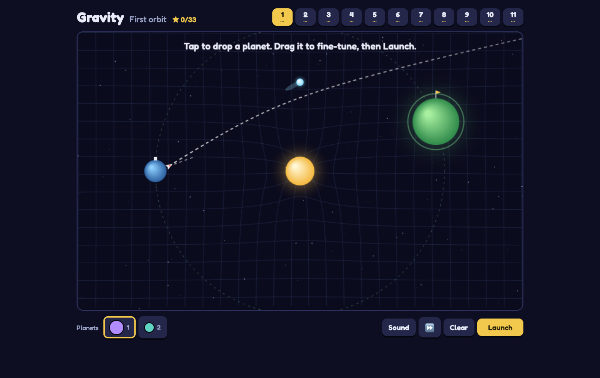

# Gravity

### ▶ [Play Gravity in your browser](https://louisvandenbruwaene.github.io/gravity/)

No install, no account: open the link and play. Tap to drop a planet, drag it to fine-tune, then Launch the rocket.

[](https://louisvandenbruwaene.github.io/gravity/)

Gravity: drop orbiting planets so the rocket coasts to its landing. One self-contained HTML file, no build step: open [`index.html`](index.html).

## Play on this Mac

```
./app/install_app.sh   # puts Gravity in /Applications
./app/make_icon.sh     # only needed after editing app/icon.html
```

The app opens the game in its own Brave window. The folder path is baked in, so re-run `install_app.sh` if this folder moves.
